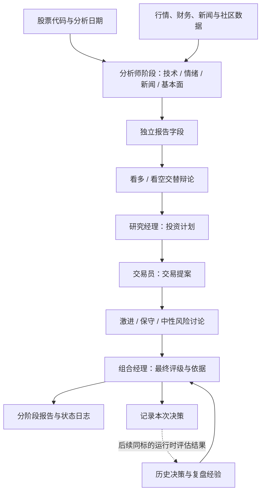

# 智能投研多 Agent 系统

基于 LangGraph 的股票研究工作流，串联行情分析、市场情绪、新闻事件、公司基本面、多空辩论与风险评估，输出包含依据、分歧和行动建议的投研报告。

**技术栈：** Python · LangGraph · LangChain · Pydantic · pandas · SQLite · Rich / Typer · Docker

本项目基于 TradingAgents 开源框架开展研究与工程实践，重点关注三个问题：**长链路中如何传递状态、如何观察执行过程、如何将历史决策转化为后续分析的上下文。** 下文展示当前仓库的实现与设计取舍。

## 项目概览

输入股票代码与分析日期后，系统按角色完成研究与决策，保留中间报告和辩论记录，便于检查最终结论的形成过程。

| 环节 | 处理内容 | 产物 |
| --- | --- | --- |
| 多维分析 | 技术指标、新闻与宏观事件、社区情绪、公司财务 | 分角色研究报告 |
| 多空研究 | 看多与看空研究员围绕报告交替辩论，研究经理归纳判断 | 投资计划与论证过程 |
| 交易提案 | 将研究判断转化为方向、入场与止损等建议 | Buy / Hold / Sell 提案 |
| 风险讨论 | 激进、保守、中性三种视角审视提案 | 风险讨论记录 |
| 最终决策 | 组合经理综合研究、风险意见与历史经验 | 五档评级与完整报告 |

最终评级为 `Buy / Overweight / Hold / Underweight / Sell`。系统输出研究建议，当前主流程没有接入券商下单执行。

## 工作流



分析师按配置顺序执行；支持工具调用的分析师通过“模型 → 工具 → 模型”循环获取证据。多空研究与风险讨论通过条件路由控制轮次，再进入对应的汇总节点。

## 工程实践与设计思考

### 1. 用显式状态组织长链路推理

以 `AgentState` 作为节点间的数据契约，将分析报告、投资辩论、交易提案、风险讨论和最终决策放入独立字段。节点接收当前状态并返回局部更新，由 LangGraph 合并，便于沿字段检查上游产物与下游输入。

- `messages` 承载模型与工具的往返消息，使用消息合并机制。
- `market_report`、`sentiment_report`、`news_report`、`fundamentals_report` 保存各分析师结论。
- `investment_debate_state`、`risk_debate_state` 保存各角色历史、当前响应和讨论轮次。
- 分析师结束后清理工具消息，后续阶段通过报告字段接收结果，控制上下文长度。

这里的关键取舍是：**消息历史与研究产物分开管理。** 当前辩论状态采用整体替换语义，分析师也复用同一消息缓冲区，因此执行顺序是状态设计的一部分；改成并行前需要重新设计状态隔离与合并规则。

实现入口：[状态定义](tradingagents/agents/utils/agent_states.py) · [图编排](tradingagents/graph/setup.py) · [条件路由](tradingagents/graph/conditional_logic.py)

### 2. 从执行过程定位问题

终端界面展示角色进度、报告更新和调用统计，运行记录支持检查数据获取、模型推理和输出解析分别发生了什么。

| 观察维度 | 当前实现 | 排查用途 |
| --- | --- | --- |
| 执行进度 | 消费图的流式状态更新，刷新角色状态与报告 | 判断流程停留在哪个阶段 |
| 调用与开销 | Callback 统计模型调用、工具调用和 Token 使用量 | 观察调用规模与上下文开销 |
| 阶段耗时 | 记录各分析师的整体耗时 | 比较不同分析阶段的运行时间 |
| 过程记录 | CLI 保存消息与工具调用日志，图执行后保存状态 JSON | 检查工具参数、返回内容与阶段产物 |
| 中断恢复 | 可选 SQLite checkpoint，按节点保存执行状态 | 从已完成步骤继续运行 |

耗时统计目前以分析师阶段为粒度。单次工具调用耗时、跨服务 Trace 和性能优化收益仍需额外埋点与对照实验。

实现入口：[调用统计](cli/stats_handler.py) · [阶段耗时](tradingagents/graph/analyst_execution.py) · [执行与状态记录](tradingagents/graph/trading_graph.py) · [断点恢复](tradingagents/graph/checkpointer.py)

### 3. 让输出具备可解析的接口

研究经理、交易员、组合经理等节点使用 Pydantic Schema 约束输出，再渲染成 Markdown，兼顾字段校验、报告阅读和下游提示词消费。结构化调用失败时记录告警，并尝试自由文本生成。

组合经理的评级通过确定性解析提取，避免为读取结论额外发起一次模型调用。结构化对象主要存在于节点内部，跨节点交接仍以状态中的文本报告为主。

实现入口：[输出 Schema](tradingagents/agents/schemas.py) · [结构化调用与回退](tradingagents/agents/utils/structured.py) · [评级解析](tradingagents/graph/signal_processing.py)

### 4. 将历史决策接入后续研究

系统将完成的决策写入本地 Markdown 记忆日志。后续再次分析同一标的时，尝试评估历史决策对应的价格表现和相对基准收益，生成复盘文本，再将同标的历史与跨标的经验注入组合经理上下文。

这一机制把“决策 → 结果观察 → 复盘 → 再次决策”连接起来，适合研究历史经验对建议的影响。目前属于提示词层面的经验复用，不涉及模型参数训练；尚未提供收益提升或自我进化能力的实验结论。

实现入口：[决策记忆](tradingagents/agents/utils/memory.py) · [复盘逻辑](tradingagents/graph/reflection.py)

### 5. 用数据证据约束分析

- 技术分析提供确定性的行情与指标校验快照，供模型核对具体价格和指标值。
- 数据接口按工具或类别配置供应商，可显式指定有序回退链。
- 对无数据、限流和未配置凭证区分处理；宏观与预测市场等可选来源失败时返回不可用说明。
- 支持分别配置快速分析模型和深度推理模型，并调整辩论轮次与输出语言。

实现入口：[行情校验](tradingagents/dataflows/market_data_validator.py) · [数据路由](tradingagents/dataflows/interface.py) · [模型客户端](tradingagents/llm_clients/factory.py)

## 快速开始

需要 Python 3.10+，建议使用 Python 3.12。进入仓库根目录后安装依赖。

### 安装与配置

Windows PowerShell：

```powershell
python -m venv .venv
.\.venv\Scripts\Activate.ps1
python -m pip install -e .
Copy-Item .env.example .env
```

macOS / Linux：

```bash
python3 -m venv .venv
source .venv/bin/activate
python -m pip install -e .
cp .env.example .env
```

编辑 `.env`，填写所选模型服务的 API Key。以下以默认 OpenAI 接入为例：

```dotenv
OPENAI_API_KEY=your_api_key
TRADINGAGENTS_LLM_PROVIDER=openai
TRADINGAGENTS_OUTPUT_LANGUAGE=Chinese
TRADINGAGENTS_MAX_DEBATE_ROUNDS=1
TRADINGAGENTS_MAX_RISK_ROUNDS=1
```

模型名称可通过 `TRADINGAGENTS_DEEP_THINK_LLM` 和 `TRADINGAGENTS_QUICK_THINK_LLM` 设置，需与所用账号和端点匹配。其他服务及本地模型的配置见 [环境变量示例](.env.example) 与 [默认配置](tradingagents/default_config.py)。默认行情与基本面供应商为 yfinance；使用 FRED、Alpha Vantage 等来源时需配置对应凭证。

### 终端运行

```bash
python -m cli.main
```

按提示选择股票代码、分析日期、分析师和模型。股票示例：`AAPL`、`0700.HK`、`600519.SS`；具体数据可用性取决于所选供应商。

开启断点恢复：

```bash
python -m cli.main --checkpoint
```

安装后也可使用 `tradingagents` 命令。Docker 启动方式为 `docker compose run --rm tradingagents`，同样需要先准备 `.env`。

### Python 调用

```python
from copy import deepcopy

from dotenv import load_dotenv

load_dotenv()  # 在导入默认配置前加载环境变量

from tradingagents.default_config import DEFAULT_CONFIG
from tradingagents.graph.trading_graph import TradingAgentsGraph

config = deepcopy(DEFAULT_CONFIG)
config.update({
    "output_language": "Chinese",
    "max_debate_rounds": 1,
    "max_risk_discuss_rounds": 1,
    "checkpoint_enabled": True,
})

graph = TradingAgentsGraph(config=config)
state, rating = graph.propagate("AAPL", "2026-09-18")
report_path = graph.save_reports(state, "AAPL", save_path="reports/aapl_demo")

print("最终评级：", rating)
print("完整报告：", report_path)
```

Python 接口需要显式调用 `save_reports()` 导出分阶段 Markdown 报告；状态日志和决策记忆在图执行完成时保存。

## 输出与复现

上述 Python 示例将报告写入：

```text
reports/aapl_demo/
├── 1_analysts/          # 技术、情绪、新闻、基本面报告
├── 2_research/          # 多空讨论与研究经理结论
├── 3_trading/           # 交易提案
├── 4_risk/              # 三种风险视角的讨论
├── 5_portfolio/         # 组合经理决策
└── complete_report.md  # 汇总报告
```

目录按实际生成的内容创建。CLI 默认在 `~/.tradingagents/logs/<股票代码>/<分析日期>/` 下保存过程日志和报告；记忆日志默认位于 `~/.tradingagents/memory/trading_memory.md`。路径可以通过配置调整。

仓库包含状态路由、结构化输出、数据供应商、报告导出和断点恢复等测试。安装开发依赖后运行：

```bash
python -m pip install -e ".[dev]"
python -m pytest -q
```

固定分析日期有助于约束行情窗口，但实时概览、新闻和社区接口并不都提供完整的历史时点数据，模型输出也存在随机性。当前系统适合流程复现与 Agent 协作研究；严格的历史回测需要额外建设时点一致的数据集与交易评估流程。

## 代码导航

```text
tradingagents/
├── agents/          # 分析师、研究员、交易员、风控与组合经理
│   ├── schemas.py   # 结构化输出定义
│   └── utils/       # 状态、工具、记忆与输出处理
├── graph/           # 图编排、条件路由、checkpoint 与复盘
├── dataflows/       # 行情、财务、新闻等数据源与路由
├── llm_clients/     # 模型服务接入与能力适配
├── reporting.py     # 分阶段报告导出
└── default_config.py
cli/                 # 交互入口、进度展示与调用统计
tests/               # 测试用例
```

## 项目来源与许可

本项目基于 [TauricResearch / TradingAgents](https://github.com/TauricResearch/TradingAgents) 开源框架，沿用其多角色投研架构及相关实现。本 README 从状态管理、执行观测和经验复用的角度重新组织项目说明。许可证见 [LICENSE](LICENSE)，上游版本记录见 [CHANGELOG.md](CHANGELOG.md)。
